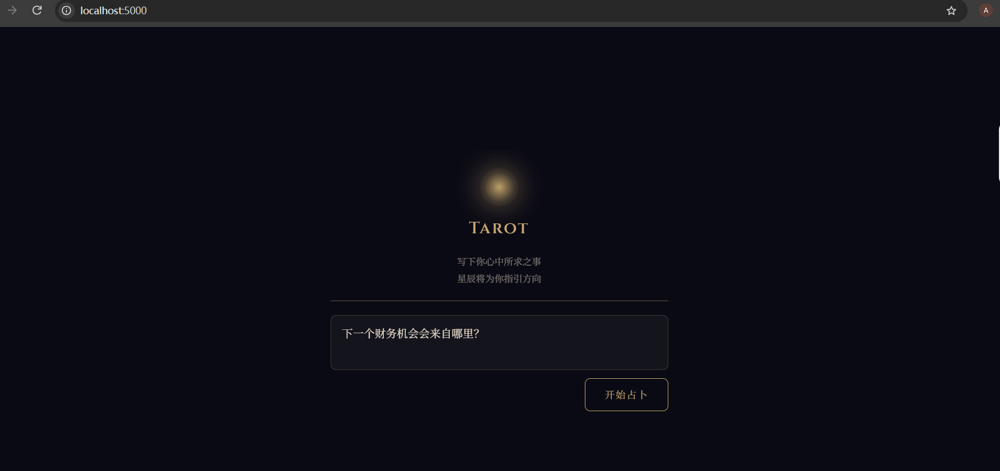
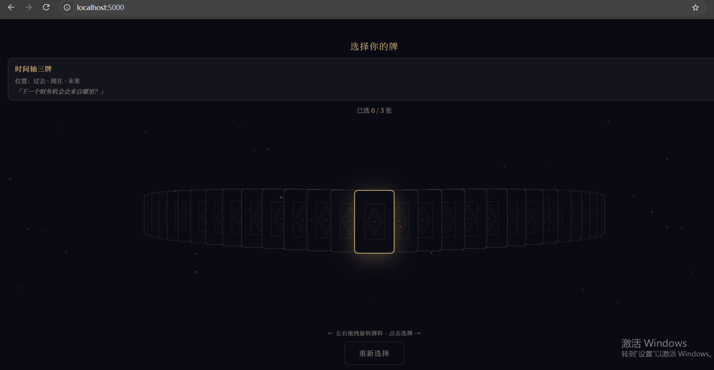

# 手势塔罗 · AI Tarot

一个基于 Flask、原生 JavaScript 和大语言模型的交互式塔罗牌项目。
用户可以输入问题，选择牌阵与塔罗牌，并获得流式 AI 解读。

## 项目截图

### 输入问题



### 选择塔罗牌



## 功能特性

- 支持中文问题输入与塔罗牌占卜流程
- 支持时间轴三牌、关系三牌、选项三牌、五牌菱形、凯尔特十字和单张指引等牌阵
- 使用安全随机方式抽取塔罗牌
- 支持正位与逆位
- 支持鼠标、触摸操作和移动端页面交互
- 支持流式 AI 解读，内容逐步显示
- 使用本地塔罗牌数据与知识库辅助解读
- 前后端同源访问，后端通过 Flask 提供静态页面和 API

## 技术栈

- Python 3.10+
- Flask
- OpenAI-compatible API
- 原生 HTML / CSS / JavaScript
- Pandas
- 本地 CSV 塔罗牌数据与知识库

## 项目结构

```text
tarot/
├── assets/cards/              # 塔罗牌图片
├── docs/screenshots/          # 项目截图
├── agent_pipeline.py          # 多 Agent 解读流水线
├── tarot_engine.py            # 抽牌与牌阵引擎
├── tarot_rag.py               # 本地塔罗知识库检索
├── server.py                  # Flask 后端入口
├── index.html                 # 页面入口
├── app.js / ui.js / state.js  # 前端应用、界面和状态逻辑
├── api.js                     # 前端 API 封装
├── gesture.js                 # 手势与交互逻辑
├── spreads_config.json        # 牌阵配置
├── tarot_cards.csv            # 塔罗牌数据
├── local_tarot_knowledge.csv  # 本地知识库
├── requirements.txt           # Python 依赖
└── .env.example               # 环境变量示例
```

## 环境要求

- Python 3.10 或更高版本
- 可访问所配置的大语言模型 API
- 现代浏览器（Chrome、Edge、Firefox 或 Safari）

## 安装与运行

### 1. 获取项目

```bash
git clone <你的 GitHub 仓库地址>
cd tarot
```

### 2. 创建虚拟环境

Windows PowerShell：

```powershell
python -m venv .venv
.venv\Scripts\Activate.ps1
```

Linux / macOS：

```bash
python3 -m venv .venv
source .venv/bin/activate
```

### 3. 安装依赖

```bash
python -m pip install -r requirements.txt
```

### 4. 配置 API

复制环境变量示例文件：

Windows：

```powershell
Copy-Item .env.example .env
```

Linux / macOS：

```bash
cp .env.example .env
```

编辑 `.env`，至少配置一个模型 API Key：

```env
ZHIPU_AI_API_KEY=你的智谱API密钥
LLM_BASE_URL=https://open.bigmodel.cn/api/paas/v4/
LLM_MODEL_NAME=glm-4
```

也可以使用其他 OpenAI-compatible 服务：

```env
OPENAI_API_KEY=你的API密钥
LLM_BASE_URL=https://api.openai.com/v1/
LLM_MODEL_NAME=gpt-4o-mini
```

### 5. 启动服务

```bash
python server.py
```

启动后访问：

```text
http://localhost:5000
```

服务默认监听 `0.0.0.0:5000`，同一局域网内的其他设备也可以通过主机 IP 访问，例如：

```text
http://192.168.x.x:5000
```

## API 接口

### `POST /api/prepare`

根据用户问题选择牌阵并抽牌。

请求示例：

```json
{
  "question": "我最近的事业发展如何？"
}
```

### `POST /api/reading`

根据用户问题和已选择的牌进行流式解读。

请求示例：

```json
{
  "question": "我最近的事业发展如何？",
  "cards": []
}
```

## 命令行模式

项目也提供命令行交互入口：

```bash
python main_console.py
```

## 测试

项目包含批量测试脚本：

```bash
python test_batch.py
```

该脚本会调用配置的大语言模型 API，可能产生 API 调用费用，并受到服务商并发限制影响。

## 安全说明

- 不要提交 `.env` 文件或任何真实 API Key。
- 仅将 `.env.example` 提交到 GitHub。
- 如果 API Key 曾经误上传或公开，应立即在服务商后台撤销并重新生成。
- 当前 Flask 配置适合本地开发和演示；正式部署时请关闭 debug，并使用生产级 WSGI 服务及 HTTPS。

## 免责声明

本项目用于娱乐、创作和自我探索，不构成医疗、法律、财务或其他专业建议。用户应根据自身判断做出重要决定。

## License

本项目使用 [MIT License](LICENSE)。
